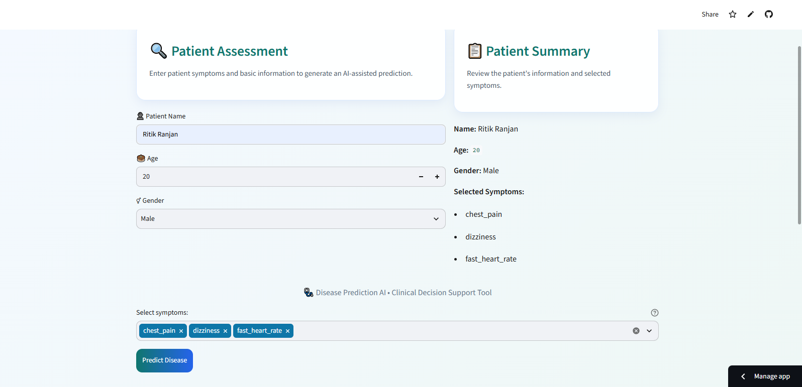
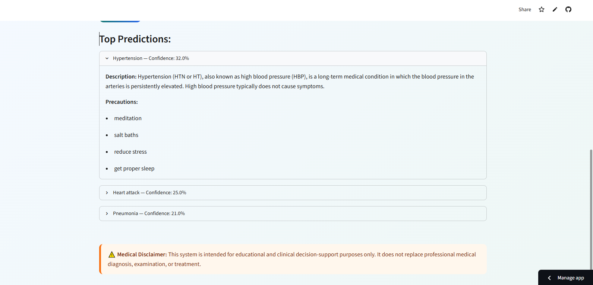

# Disease Prediction AI: Clinical Decision-Support Tool

[](https://disease-ai-app-dqxwxffuyy3vq8wpnahova.streamlit.app/)


A machine learning web app that takes a list of symptoms and returns the **top 3 most likely diseases**, each with a **confidence score**, a **description**, and **precautions**. It is built for **medical students and staff** as a learning and decision-support aid.

**Live demo:** https://disease-ai-app-dqxwxffuyy3vq8wpnahova.streamlit.app/  

> Free Streamlit hosting puts apps to sleep when unused. If you see a "get this app back up" button, click it and wait about a minute.




---

## Important disclaimer

This is an **educational tool**. It is **not** a medical device and **not** a substitute for professional diagnosis. Predictions are based on symptoms only and on a clean, rule-based dataset, so real-world accuracy will be lower. Always confirm with clinical examination, lab tests, and physician judgment.

---

## Features

- Select from **131 symptoms** with a searchable multi-select box
- **Top-3 differential list** with a confidence percentage for each disease
- Disease **description** and **precautions** for every prediction
- Honest behavior on partial input: confidence drops when symptoms are vague
- Readable **light theme** on phones, including devices set to dark mode
- Optional **REST API** (`api.py`) so other apps and websites can request predictions
- Runs on free tools end to end

## How it works

```
Selected symptoms
      |
      v
131-column 0/1 row (same column order as training)
      |
      v
Random Forest (100 trees)  ->  probability for each of 41 diseases
      |
      v
Top 3 diseases  ->  description + precautions from CSV files
      |
      v
Result shown in the app
```

1. Each case in the dataset lists up to 17 symptoms. These are converted to **131 binary columns** (one-hot encoding): 1 if the symptom is present, 0 if not.
2. A **Random Forest classifier** (100 decision trees) is trained on 80% of the data and tested on the hidden 20%.
3. At prediction time, `predict_proba` gives a probability for every disease, and the three highest are shown.
4. Descriptions and precautions are looked up from the dataset's CSV files.

## Dataset

[Disease Symptom Prediction / Disease Symptom Description Dataset](https://www.kaggle.com/) on Kaggle (author: itachi9604).

| File | Contents |
|---|---|
| `dataset.csv` | Disease with up to 17 symptoms per case (4,920 rows) |
| `symptom_Description.csv` | Description for each disease |
| `symptom_precaution.csv` | Up to 4 precautions per disease |
| `Symptom-severity.csv` | Severity weight per symptom (not used yet) |

**41 diseases, 131 symptoms.**

## Results and honest notes on accuracy

- Random Forest, Decision Tree, Naive Bayes and SVM all scored **1.0** on the held-out test set. This reflects how clean and rule-based the dataset is. It is **not** evidence of real-world accuracy.
- Random Forest was chosen because it provides probability scores for the confidence and top-3 features.

Example behavior:

| Input | Top result |
|---|---|
| itching, skin_rash, nodal_skin_eruptions | Fungal infection, 100% |
| itching (alone) | Fungal infection, 31% (low confidence, as expected) |
| vomiting, chest_pain | Heart attack 73%, GERD 10%, Hypertension 6% |

## Project structure

```
disease-ai-app/
├── app.py                    # Streamlit web app
├── api.py                    # FastAPI service (optional)
├── disease_model.pkl         # Trained Random Forest model
├── symptom_columns.pkl       # Exact symptom column order used in training
├── symptom_Description.csv   # Disease descriptions
├── symptom_precaution.csv    # Disease precautions
├── Symptom-severity.csv      # Symptom severity weights (reserved for future use)
├── requirements.txt          # Dependencies for the Streamlit app
├── requirements-api.txt      # Dependencies for the API
└── .streamlit/
    └── config.toml           # Light theme
```

## Run locally

Requires Python 3.11 (recommended).

```bash
git clone https://github.com/ritikranjan836-stack/disease-ai-app.git
cd disease-ai-app
pip install streamlit scikit-learn==1.6.1 pandas joblib
python -m streamlit run app.py
```

The app opens at `http://localhost:8501`.

> The model was trained with **scikit-learn 1.6.1**. Using the same version avoids an `InconsistentVersionWarning`.

## API (optional)

Run locally:

```bash
pip install fastapi uvicorn
python -m uvicorn api:app --reload
```

Open `http://127.0.0.1:8000/docs` for interactive documentation.

| Method | Endpoint | Description |
|---|---|---|
| `POST` | `/predict` | Send symptoms, receive the top-3 predictions |
| `GET` | `/symptoms` | List all valid symptom names |

Example request:

```json
{ "symptoms": ["vomiting", "chest_pain"] }
```

Example response (shortened):

```json
{
  "input_symptoms": ["vomiting", "chest_pain"],
  "top_predictions": [
    {
      "disease": "Heart attack",
      "description": "The death of heart muscle due to the loss of blood supply...",
      "precautions": ["call ambulance", "chew or swallow asprin", "keep calm"],
      "confidence": "73.0%"
    }
  ],
  "disclaimer": "Educational decision-support tool. Not a substitute for professional medical diagnosis."
}
```

CORS is enabled so websites can call the API from a browser.

## Embed in a website

```html
<iframe src="https://disease-ai-app-dqxwxffuyy3vq8wpnahova.streamlit.app/?embed=true"
        width="100%" height="800" style="border:none;"></iframe>
```

## Deployment

- **App:** Streamlit Community Cloud (free), connected to this repository, main file `app.py`.
- **API:** can be deployed on a free host such as Render using `requirements-api.txt` and the start command `uvicorn api:app --host 0.0.0.0 --port $PORT`.

## Limitations

- Uses **symptoms only**. It cannot read lab reports yet.
- The dataset is clean and rule-based, so it does not capture the overlap and noise of real patients.
- Precautions come from a general dataset, not from clinical guidelines.
- Not validated by medical professionals.

## Roadmap

- [ ] Add **lab report values** (for example blood sugar, WBC, hemoglobin) with a second model
- [ ] Readable symptom names ("Skin rash" instead of `skin_rash`) and symptom categories
- [ ] Use the severity file to weight predictions
- [ ] Test on messy and partial inputs, with review by medical professionals
- [ ] Cite sources for precautions and add reference ranges
- [ ] Android app (WebView first, then a custom app using the API)

## Tech stack

Python, pandas, scikit-learn, joblib, Streamlit, FastAPI, uvicorn, GitHub, Streamlit Community Cloud.

## Author

**[Ritik Ranjan]**
GitHub: [@ritikranjan836-stack](https://github.com/ritikranjan836-stack)
LinkedIn: [[Ritik Ranjan](https://www.linkedin.com/in/ritik-ranjan-01052007rr/)]

Built while completing an AI in Python course from IIT Pravartak.

## Acknowledgements

- Dataset by itachi9604 on Kaggle
- Streamlit and scikit-learn open-source communities

